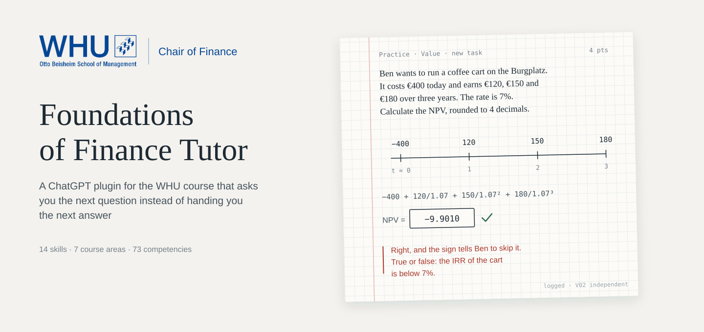
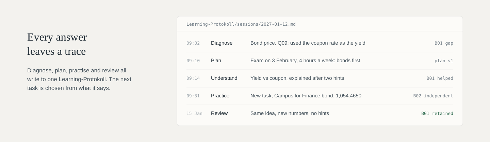

# Foundations of Finance Tutor

**One course. One plugin. A personal path from “I have seen this” to “I can explain and use it.”**

A self-contained learning plugin for **ChatGPT and compatible skill-based agents**, built around the WHU Foundations of Finance curriculum. It combines Socratic tutoring, adaptive diagnostics, a realistic study plan, worked practice and a continuous learning protocol. The teaching references are included: students do not need to upload lecture slides or install another learning app.

**14 skills · 7 course areas · 73 competency groups · 36 worked numerical exercises · unlimited fresh exam-style tasks**

[Start learning](#start-learning) · [Explore the skills](#all-fourteen-skills) · [Example prompts](#example-prompts) · [See the curriculum](#the-whole-course-in-one-place) · [Understand progress](#progress-that-shows-its-evidence) · [Install](#installation)

## Start learning

Select **Foundations of Finance** from your installed plugins, then try:

> I am preparing for Foundations of Finance. Find out where I should start, ask one question at a time, and build a study plan around my available time.

The companion starts with what you actually know. It asks for the individual details that matter, such as your deadline and available study time, rather than assuming everyone needs the same sequence.

Already know the gap? Go straight there:

> I keep mixing up present value and net present value. Help me reason through the difference, then give me a fresh problem.

> My exam is in three weeks. I can study 45 minutes on Mondays, Wednesdays and Fridays. Read my learning protocol and adapt my plan.

> Quiz me on the full behavioral-finance glossary, including the less familiar biases. Do not reveal the answer before I try.

> Generate a fresh 20-minute mixed check in exam style. Afterwards, show which areas were tested and what I should work on next.

Teaching defaults to English. You can ask for German explanations while retaining the English finance terminology.

## How learning works



1. **Diagnose:** answer a small set of questions, one at a time. Untested areas remain visibly untested.
2. **Plan:** give your deadline, realistic availability and prior progress. The planner can run a fresh diagnostic before setting priorities.
3. **Understand:** predict, explain and connect ideas. When you are stuck, the tutor narrows the question or gives a short explanation.
4. **Practice:** solve original numerical and conceptual tasks. Hints arrive in stages; a complete explanation is available when you ask.
5. **Review:** retrieve earlier ideas after a gap and mix them with new work. The next task changes when your answers reveal a different need.

A one-off question still gets a direct answer. You can switch topics, ask for a full solution, adjust difficulty or change the plan at any time.

## All fourteen skills

You can use natural language throughout. In clients that support `$skill-name`, the identifiers below also provide direct entry points. All skills belong to this single package and share the same learning record.

### Learning workflows

| Skill | Use it when… | Example |
|---|---|---|
| [`fof-coach`](skills/fof-coach/SKILL.md) | You want a guided learning session or an explanation. | “Help me understand finance from my current level.” |
| [`fof-diagnose`](skills/fof-diagnose/SKILL.md) | You need to find your starting point or check gaps. | “Test what I actually understand across the course.” |
| [`fof-study-plan`](skills/fof-study-plan/SKILL.md) | You want a feasible schedule that adapts to your progress. | “Ask about my deadline and study time, then make a plan.” |
| [`fof-practice`](skills/fof-practice/SKILL.md) | You need to choose and apply a method yourself, on bank tasks or brand-new exam-style ones. | “Write me a new bond immunization task with a Campus for Finance story.” |
| [`fof-review`](skills/fof-review/SKILL.md) | You want earlier material to stay usable. | “Check what we covered last week with fresh numbers.” |
| [`fof-mock`](skills/fof-mock/SKILL.md) | You want a timed, freshly generated exam-style sheet. | “Generate a full 90-minute mock with one running story and score my final answers.” |
| [`fof-progress`](skills/fof-progress/SKILL.md) | You want your board, evidence or portable learning record. | “Show my weakest tested areas and my next task.” |

### Subject tutors

| Skill | Included topics |
|---|---|
| [`fof-valuation`](skills/fof-valuation/SKILL.md) | Cash-flow timelines, PV/FV, NPV, reservation prices, annuities, financing plans, perpetuities and IRR. |
| [`fof-bonds`](skills/fof-bonds/SKILL.md) | Coupon and zero bonds, yield curves, payment frequency, duration, convexity, immunization and credit risk. |
| [`fof-portfolios`](skills/fof-portfolios/SKILL.md) | EMH, expected utility, certainty equivalents, risk preferences, state probabilities, covariance, diversification, MVP and constraints. |
| [`fof-capm`](skills/fof-capm/SKILL.md) | Beta, systematic/residual risk, CML, SML, alpha, leverage, beta matching and risk-adjusted valuation. |
| [`fof-derivatives`](skills/fof-derivatives/SKILL.md) | Forwards/futures, hedging, arbitrage, options, parity, one-period binomial replication, payoff strategies and exchange-rate relations. |
| [`fof-crypto`](skills/fof-crypto/SKILL.md) | Ledgers, double spending, hashes, signatures, PoW, PoS, PoH, issuance, smart contracts, NFTs and economic rights. |
| [`fof-behavioral`](skills/fof-behavioral/SKILL.md) | The full decision-process bias glossary, social/AI amplification, market anomalies, prospect theory and structured payoffs. |

## Fresh exam-style tasks, with a story

Practice, review and mock can write **new tasks on demand** instead of recycling a fixed bank. Like the real exam, which runs in ANS, exam-style tasks only have answers with one correct result: a number to four decimals, single choice, true/false or fill-the-gap. Open "explain why" questions appear in tutoring for understanding and are always marked as not part of the exam format. They follow the house style of recent Foundations of Finance assessments: one running story per sheet, data tables, multi-part calculations rounded to four decimals, fill-the-gap decisions and four-option single-choice items, and the usual section weights for a 90-minute simulation.

The stories live in the WHU world: a graduate who founds a brewery at Burgplatz, a fictional *Campus for Finance Capital Partners* advising on immunization, Euromasters jerseys hedged with forwards, IdeaLab! start-ups with awkward IRRs, Rhine-side cafés valued as growing perpetuities. All companies and figures are fictional.

Every generated task is solved and checked before you see it. Where the host can run code, the bundled [`fof_calc.py`](skills/fof-coach/scripts/fof_calc.py) recomputes NPV, annuities, IRR, bond prices and durations, immunization weights, portfolio statistics, CAPM betas, forwards, parity and binomial prices; otherwise the tutor solves it by two independent routes. The task, its story and answer key go into your Learning-Protokoll so the next session can continue the story.

> Give me a new exam-style CAPM question. Same story as last time, harder numbers, and don't tell me which formula to use.

See [how tasks are generated](skills/fof-coach/references/task-generation.md).

## Example prompts

Copy any of these into a new chat once the plugin is installed. They work in English or German; the tutor answers in the language you write in. Each group says what you should see, which makes the list useful for testing as well as for learning.

<details open>
<summary><b>Getting started and diagnosis</b> · <code>fof-coach</code>, <code>fof-diagnose</code></summary>

- I'm preparing for Foundations of Finance. Find out where I should start. Ask one question at a time.
- I've never really understood finance. Start from zero and tell me what to look at first.
- Run a short diagnostic across all seven course areas and show me my learning board afterwards.
- Only check Bonds and CAPM. I think the rest is fine.
- Ich schreibe die Klausur in vier Wochen. Finde heraus, wo ich stehe, und erkläre auf Deutsch, aber lass die Fachbegriffe auf Englisch.

*What to look for:* one question per message, no solutions during the diagnostic, and afterwards a board that separates tested from untested areas.
</details>

<details>
<summary><b>Study plan</b> · <code>fof-study-plan</code></summary>

- Make me a study plan for Foundations of Finance. Ask me what you need to know first.
- My exam is on 3 February. I can study 45 minutes on Mondays, Wednesdays and Fridays and two hours on Sundays. Build a plan.
- I missed two study days this week. Adapt my plan without overloading the next days.
- I have only one week left. What should I prioritise?
- Read my Learning-Protokoll and tell me whether I'm on track.

*What to look for:* follow-up questions about exam date, time and current level; an offer to run a diagnostic; a dated plan saved as `LERNPLAN.md`.
</details>

<details>
<summary><b>Understanding a topic</b> · <code>fof-coach</code> and the subject tutors</summary>

- I keep mixing up present value and net present value. Help me work out the difference myself.
- Explain duration to me. Don't just give me the formula, ask me questions until I get it.
- Why is beta not the same as total risk?
- What is the difference between a forward and an option? Use a WHU example.
- Walk me through put-call parity step by step, and let me do the calculations.
- What does proof of stake change compared with proof of work?
- Explain the disposition effect and give me an example from student life.
- Just give me the direct answer: what is the formula for a growing perpetuity?

*What to look for:* guiding questions instead of an answer dump, a direct answer when you ask for one, and open "explain why" questions marked as not part of the exam format.
</details>

<details>
<summary><b>Practice with new exam-style tasks</b> · <code>fof-practice</code></summary>

- Give me a new exam-style NPV task with a WHU story.
- Write me a bond immunization task with a Campus for Finance story, like in the 2026 exam.
- Give me a portfolio task with four years of returns for two stocks. Ask for the MVP weights.
- Generate a CAPM question: beta, expected return and alpha, with a fill-the-gap at the end.
- Give me a futures arbitrage task where the observed price is wrong.
- Give me five single-choice questions on behavioral biases.
- Mixed practice: three calculation tasks from different chapters, and don't tell me which formula to use.
- Same story as last time, harder numbers.
- I'm stuck. Give me a hint, not the solution.
- Show me the full solution now.

*What to look for:* a story, all data, a stated rounding rule (4 decimals); only closed formats (number, single choice, true/false, fill-the-gap); staged hints; no answers in suggested replies.
</details>

<details>
<summary><b>Review and retrieval</b> · <code>fof-review</code></summary>

- Check whether I still remember what we did last time.
- Review the topics from last week with new numbers.
- Quiz me on the full behavioral-finance glossary, including the less familiar biases.
- Give me a mixed review: one old topic, one new topic.

*What to look for:* questions without explanation first, and a lower status in the protocol if you have forgotten something.
</details>

<details>
<summary><b>Mock exam</b> · <code>fof-mock</code></summary>

- Run a full 90-minute mock exam with one running story, like the real exam.
- Give me a 20-minute mixed mock and score my final answers.
- Mock exam for Derivatives only, 30 minutes.
- Show me the whole sheet at once; I'll send all answers at the end.
- I'm done. Score it and tell me what to revise.

*What to look for:* points and time stated at the start, no feedback during the mock, scoring without partial points, then a revision list.
</details>

<details>
<summary><b>Progress and the Learning-Protokoll</b> · <code>fof-progress</code></summary>

- Show my learning board.
- How ready am I for the exam, and what is that number based on?
- Which three topics should I work on next?
- Export my learning passport so I can continue in a new chat.
- Resume from my Learning-Protokoll and choose the next task.

*What to look for:* a readiness index with coverage and an explicit "not a pass probability" note; a `Learning-Protokoll/` folder (or a downloadable copy) with `STATUS.md`, `LERNPLAN.md` and dated session logs.
</details>


## The whole course, in one place

The package includes an expanded [course companion](FoF_Course_Companion.md), a [competency-by-competency coverage map](skills/fof-coach/references/coverage.md), prerequisite relationships, original concept checks, worked calculations and common misconceptions.

The learning edition builds on the archived course summary and cross-checks the 2025–2027 materials. It explicitly fills gaps in expected utility, certainty equivalents, market efficiency, portfolio constraints, risk decomposition, FX parity and the detailed behavioral glossary.

**Course coverage is not an exam prediction.** The companion supports the documented curriculum. It cannot reconstruct every oral classroom inclusion or exclusion or promise future questions. An explicit instructor scope update can narrow a learner's stated goal without silently erasing the rest of the curriculum. Advanced extensions are labelled as such. See [scope and boundaries](skills/fof-coach/references/scope.md).

## A learning protocol that carries forward

Every skill records the learning process, rather than keeping only a final score. In a personal writable workspace it creates:

```text
Learning-Protokoll/
├── STATUS.md              Current understanding, gaps and next task
├── LERNPLAN.md            Your current study plan
├── state.json             Portable evidence and progress
├── plan.json              Availability, deadline and planned blocks
├── sessions/
│   └── YYYY-MM-DD/
│       └── session-id.md  Questions, answers, hints and feedback
└── events/
    └── event-id.json      Recoverable, ordered learning history
```

The tutor reads the existing record before choosing work. Each substantive question, attempt, explanation, hint and plan change is recorded. A wrong answer is useful evidence; an unanswered task stays pending. The planner adjusts remaining work after difficult checks, successful retrieval or missed study sessions, while respecting your time budget.

**In ChatGPT without a writable local folder**, the companion uses native downloadable files when available. That is a session copy you can export and bring back, not an automatic write to your computer. If file creation is unavailable, it maintains a visible, copyable protocol in the chat and says that it has not saved it to disk. No additional storage plugin is required. See the [journal contract](skills/fof-coach/references/journal.md).

To continue later:

> Resume from my Learning-Protokoll. Read my current status and study plan, then choose the next useful task.

Personal learning records stay outside the distributed course resources. No student identifiers or lecturer analytics are needed. You can request a different destination, less detail or no storage.

## Progress that shows its evidence

The board separates **not assessed**, **helped**, **independent**, **retained** and **transferable** understanding. It does not mistake confidence, reading a solution or repeating an answer immediately for mastery.

The **demonstrated readiness index** is a transparent summary across seven equally weighted areas. It is always shown with assessed coverage and an unknown-area range. A short diagnostic cannot establish readiness across the whole course. The index is **not a probability of passing**, and it has not been statistically calibrated against exam outcomes.

Mock scores are separate: each declared final-answer field is correct or incorrect, without partial points for an incorrect result. Learning feedback still explains the method and the first substantive error. See [evidence and assessment rules](skills/fof-coach/references/assessment.md).

## Installation

**Quickest way:** paste the repository link into ChatGPT, Codex or Claude Code and ask it to install the plugin, for example:

> Please install the plugin from https://github.com/armins128/Foundations-of-Finance-Tutor

The assistant reads the repository and sets up the plugin for you. The steps below do the same thing by hand.

This repository is the plugin package. `skills/` sits at its root; `.codex-plugin/plugin.json` is the manifest for ChatGPT/Codex, `.claude-plugin/plugin.json` lets Claude Code load the same skills, and `plugin.json` follows the open Agent Plugins schema. It has no MCP server, external API, paid data source or third-party learning-app dependency. You need a compatible ChatGPT/agent environment that supports skills and access to the supplied references.

**For a local desktop pilot:** open the repository as a project. Its `.agents/plugins/marketplace.json` exposes Foundations of Finance as a local plugin source in supported clients. Restart/refresh the client, install it from that source and test in a new chat. Availability varies by client and workspace.

**For Claude Code:** the repository doubles as a plugin marketplace via `.claude-plugin/marketplace.json`. Add it and install the plugin for your user account (available in every project):

```bash
claude plugin marketplace add https://github.com/armins128/Foundations-of-Finance-Tutor.git
claude plugin install foundations-of-finance@foundations-of-finance-tutor --scope user
```

Start a new session afterwards; the skills appear as `foundations-of-finance:fof-coach`, `foundations-of-finance:fof-practice` and so on. The short form `claude plugin marketplace add armins128/Foundations-of-Finance-Tutor` also works if your GitHub access uses SSH keys. Update later with `claude plugin marketplace update foundations-of-finance-tutor` followed by `claude plugin update foundations-of-finance@foundations-of-finance-tutor`.

**For ChatGPT workspace distribution:** use the workspace's supported plugin creation or GitHub import workflow, retaining all bundled skills and reference files. Test privately before sharing. Students then install/select the one Foundations of Finance plugin; they do not install fourteen separate skills or upload course decks.

The relevant official guides are [Package your plugin](https://developers.openai.com/plugins/build/plugins) and [Build plugins in ChatGPT](https://learn.chatgpt.com/docs/build-plugins).

## Design and validation

The tutoring design takes inspiration from [Jane Street's Socratic Tutor](https://github.com/janestreet/agent_skills/tree/master/socratic-tutor) and [LearnHarness](https://github.com/amosblomqvist/learnharness): reason first, diagnose prerequisites, separate understanding from practice, and revisit earlier knowledge. This implementation supplies its own course-specific instructions, learning record and exercises; neither project is a runtime dependency, and no upstream code or prompt text is bundled.

Local checks cover skill references, prerequisite cycles, numerical cross-checks, evidence scoring, safe/idempotent learning logs and study-plan capacity validation. Maintainers can reproduce them with `python tools/check_package.py` using Python 3.10 or later; students do not need to run it. [Validation notes](VALIDATION.md) distinguish these checks from the student-dialogue and installation tests that remain. The readiness index is a learning heuristic, and model feedback can still be wrong. Ask the tutor to show a calculation or its bundled course reference when something looks inconsistent.

The repository contains learning summaries and original practice, not original lecture decks, historical exam papers, grade records or student correspondence.

## License

© 2026 Chair of Finance, WHU – Otto Beisheim School of Management. Licensed under [CC BY-NC-SA 4.0](https://creativecommons.org/licenses/by-nc-sa/4.0/): you may share and adapt the material for non-commercial purposes if you credit the Chair of Finance and release your changes under the same license. The WHU name and logo are trademarks of WHU and are not covered by this license. See [LICENSE](LICENSE).
